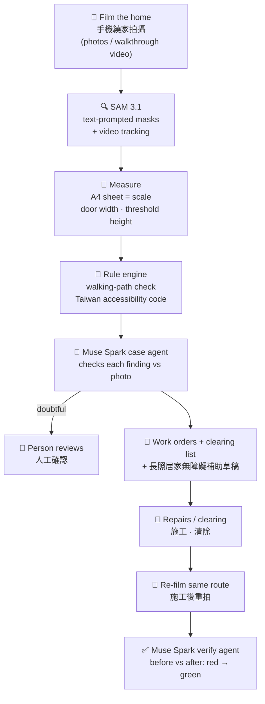

# SafePath AI 🏠

**Film an elder's home, get it fixed, prove it's fixed.**

Meta Global AI Developer Hackathon 2026 · Indie Developer · Build for Your World

🌐 **Live demo:** https://demo.jxdtw.com/metademo (demo homes are **SIMULATED**: scenes generated with Muse Image, scale assumed)
🎬 **Demo video (2:49):** https://youtu.be/L1akx5FGETA · 📄 **Sample subsidy draft:** [docs/demo-subsidy-draft.pdf](docs/demo-subsidy-draft.pdf)

## 💡 What it is
A family films the home with a phone. SafePath finds what blocks the way, measures it, and writes the paperwork for Taiwan's long-term-care home-accessibility subsidy.
After the repair, they film again: red turns green only with evidence.

## ⚙️ How it works


- 🚦 Verdicts come from a rule table, not from the model; borderline measurements go to a person with a tape measure.
- 🛑 The agent checks every finding against its photo and can flag it for review, but it can't change a number or clear a red finding itself.

| Stage | Code |
|---|---|
| prepare → segment → measure → assess → paperwork \| verify | [src/Job/Pipeline.php](src/Job/Pipeline.php) |
| SAM 3.1 masks / tracking | [src/Vision/SamTool.php](src/Vision/SamTool.php) |
| Rules (path check, limits) | [src/Rules/RuleEngine.php](src/Rules/RuleEngine.php) |
| Agents | [src/Agent/CaseAgent.php](src/Agent/CaseAgent.php), [src/Agent/VerifyAgent.php](src/Agent/VerifyAgent.php) |
| Subsidy draft | [src/Subsidy/SubsidyPack.php](src/Subsidy/SubsidyPack.php) |

## 🤖 How we use Meta models
| Model | Job |
|---|---|
| **SAM 3.1** | Text-prompted masks for 11 hazard classes; tracks objects through walkthrough video so each one counts once; masks drive the walking-path check and measurement |
| **Muse Spark** | Two multi-turn tool-calling agents: one inspects every finding and writes work orders and the subsidy draft, the other confirms repairs before vs after (`verify_after`) |
| **Muse Image** | Generated the simulated before/after demo scenes |
| **Muse Voice Transcribe** | Family describes how the resident moves; the audio isn't kept |

## 📏 Measurement accuracy (real photos, tape-measured)
| What | Result | So SafePath… |
|---|---|---|
| Door clear opening width | 6–10% off (front door −6% to −9%, bathroom +10%) | reports it as a reference value |
| Door height | about 20% short; often cut off by the photo edge | doesn't report it |
| Threshold height | 3.5 cm read as 3.8 cm; a shot from above read 6.6 cm | asks for a tape measure when unsure |
| False alarms | none: hanging bags, washing machine, towel, slippers beside the path were "noted only" | — |

Details: [docs/measurement-validation.md](docs/measurement-validation.md)

## 🚀 Quick start
```bash
scripts/install.sh   # PHP deps, samtool venv (Python 3.12), .env, DB migration
php bin/seed_demo.php
scripts/dev.sh       # http://localhost:8080
scripts/smoke.sh
```
Deploy to a server: [docs/deploy.md](docs/deploy.md)

## 📸 Shooting tips
- **Threshold:** tape an A4 sheet on the lower door next to it; phone at threshold height, facing its front.
- **Door width:** A4 in the middle of the door; face it straight on; whole door in view.
- Sizes are reference values. If a threshold height isn't reliable, SafePath shows no number and asks for a tape measure.

## 🧭 Scope
Home environment safety and subsidy paperwork only. **No health, fall-risk or medical assessment.** Every subsidy package is a draft pending professional assessment.

## 🆕 Built during the hackathon
All code in this repository was written during the event, starting 2026-10-27. Nothing was carried over from earlier projects.

## 🧱 Stack
PHP 8.3+ (native, PSR-4) · MySQL 9.0.1 · ffmpeg · Python 3.12 helper with Meta's official `meta-sam-parser`

## ✅ Tests
```bash
vendor/bin/phpunit
helpers/samtool/.venv/bin/python -m unittest tests/test_samtool.py
```

## License
MIT
